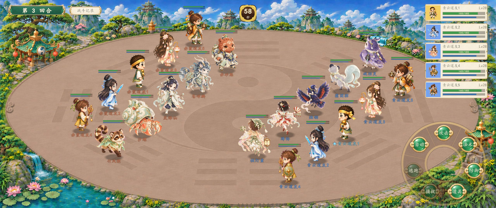

# xuanming-ai-workspace

多仓库 AI 协作总控工作区：集中管理跨仓库共享的 `AGENTS.md`、通用 `docs/rules/`、自定义 `.agents/skills/`，并以**安全松耦合 Git Submodule** 挂载全部 5 个业务仓库。

## 游戏预览与类型简介（《五行奇谈》）



> *实机研发画面（2560×1080）：5v5 人宠满编 20 单位四排阵位（双方各 5 名角色 + 5 只灵宠）、脚下名牌避让布局、团队血蓝面板与回合指令轮盘。*

- **游戏类型**：东方道家五行题材**人宠回合制 MMORPG**（大世界 ECS 场景探索 + 1v1～5v5 独立战斗节点直连回合对战）。
- **核心理念**：主打**“有空就玩、随时能停”**（零每日签到打卡、零日清活跃条、零固定钟点排班），人宠技能与五行阵法策略博弈，免费玩家可达 100% 相同战力上限。
- **目标平台**：同一套 Unity 客户端面向**微信 / 抖音小游戏（WebGL2）**与 **iOS / Android 原生 App** 双形态研发；三套服务端共享同一份客户端契约，可无缝切换。
- **独立项目说明**：除 MMORPG 4 仓外，本工作区亦挂载独立的 Pandora 5v5 MOBA Go 服务端（`xuanming-server`），与《五行奇谈》相互独立。

## 项目完成进度（截至 2026-11-27，未上线研发中）

| 模块 / 仓库 | 当前状态 | 已完成内容与待办摘要 |
|---|---|---|
| **核心玩法与回合战斗** | ✅ 主体已落地 | 1v1～5v5 人宠回合引擎（20 单位四排阵位、战前禁选与护招破禁、观战与战报回放）、首领试炼（3 常驻首领 + 卷四三境明雷 + 4 项试炼誓约）、人宠会武、十季循环赛季技印（S1–S10）、帮会全天帮战与宿敌约战、五行幻境 V2（6 关分岔轻肉鸽）、万象残局坊（UGC 残局解谜）、江湖恩怨生死状、装备打造/品相/制书 |
| **C++ / Go / Java 权威服务端** (`xuanming-server-mmo-cpp`) | ✅ 主体已落地 | 3 类 C++ 运行节点（`gate` / `scene` / `battle`）+ 20+ Go 微服务 + Java HTTP 网关；150+ 协议文件、83 张配表、550+ 客户端消息号；已支持本地一键起服、Docker/K8s 部署清单与全链路自动生成 |
| **Java 21 独立服务端** (`xuanming-server-mmo`) | ✅ 主体已对齐 | 36 模块全链路并行演进，共享客户端契约（试炼志 V4、战前禁选 V2、残局坊 V1.5、反打卡治理等已对齐；最新增量如五行幻境 V2 按 `PARITY.md` 持续同步） |
| **Python 独立服务端** (`xuanming-server-mmo-python`) | ✅ 全服务平替 | 纯 Python 单进程本地存档一键启动 + 全微服务集群模式，已按 C++ 基线完成核心节点与业务服务增量移植，持续跟进最新特性 |
| **Unity 客户端** (`mmorpg-client`) | 🟡 主体已接入 | 登录/选区/建角、天墉城及多张大世界地图导航、20 单位战斗舞台与直连断线恢复、70+ UI 资产目录与协议/配表自动生成已接入；**进行中**：部分新玩法切片导入、全量角色/宠物/地图高精美术覆盖、音频与 Addressables CDN 分包 |
| **合规与上线前门禁** | ⏳ 发版前待补齐 | 实名防沉迷、7 天冷静期注销、UGC 内容审核与零拒审支付/激励广告骨架已内置（默认关闭）；**上线前待办**：Linux 预发阶梯压测、小游戏 WebGL2 正式转包与 iOS/Android 真机联调、安全存储/反作弊加固、版号与商店/备案资质 |

## 挂载仓库一览

| 分组 | 目录 | 角色 | 远端仓库 |
|---|---|---|---|
| MMORPG | `mmorpg-client` | Unity 客户端 | `luhailong-cpp/mmorpg-client` |
| MMORPG | `xuanming-server-mmo-cpp` | C++ 节点 + Go 微服务 | `luyuan-cpp/xuanming-server-mmo` |
| MMORPG | `xuanming-server-mmo` | Java 21 服务端 | `luyuan-java/xuanming-server-mmo` |
| MMORPG | `xuanming-server-mmo-python` | Python 服务端 | `luhailong-python/xuanming-server-mmo-python` |
| Pandora | `xuanming-server` | Pandora Go 服务端（MOBA） | `luyuan-go/xuanming-server` |

## 新电脑上手（3 步）

> ⚠️ **不要**使用 `git clone --recursive`（`xuanming-server-mmo-cpp` 内部含 20+ 第三方子模块，递归拉取极慢且会把子仓切为 detached HEAD）。

```powershell
# 1. 克隆总仓（不含 --recursive）
git clone git@github.com:luyuan-cpp/xuanming-ai-workspace.git xuanming-workspace
cd xuanming-workspace

# 2. 一键拉齐 5 个一级子仓到 main 分支，并自动启用 ignore=all / update=none 防误覆盖保护
pwsh -File scripts/bootstrap.ps1

# 3. 安装必装 80 个精选全局 AI Skills（按文档第 2 节执行，已去重防截断）
# 详见 docs/rules/required-skills.md
```

## 日常协作方式

- **改通用规则或跨仓自定义 Skill**：只改本总仓（`AGENTS.md`、`docs/rules/`、`.agents/skills/`）并在本仓提交推送。
- **改业务代码**：进入对应子仓正常在 `main` 分支开发、提交与推送；因为 `.gitmodules` 配置了 `ignore = all` 与 `update = none`，各子仓日常变更不会把总仓标脏，也不会因误触 `git submodule update` 而回退。
- **里程碑同步子仓指针（可选）**：仅当需要刷新 GitHub 上显示的各子仓提交号时，手动用各仓已推送的 `origin/main` SHA 更新 gitlink：
  ```powershell
  $sha = (git -C mmorpg-client rev-parse origin/main).Trim()
  git update-index --cacheinfo "160000,$sha,mmorpg-client"
  ```
